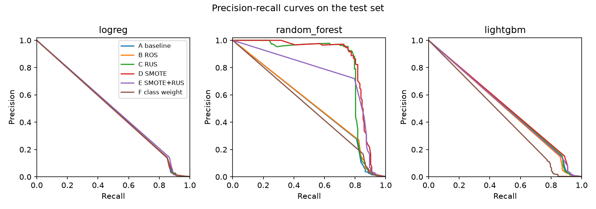
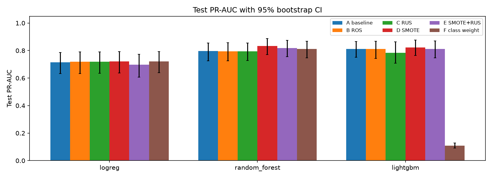

# An Empirical Study of Class-Imbalance Handling Techniques for Credit Card Fraud Detection

This is our student group project. Only about 0.17% of the payments in the ULB credit-card
dataset are frauds, so a model that always says "legit" is 99.8% accurate and useless. We
compare six ways of dealing with that imbalance (A no treatment, B random oversampling, C random
undersampling, D SMOTE, E SMOTE then random undersampling, F class weighting) on five models
(logistic regression, random forest, LightGBM, XGBoost, CatBoost). Every technique gets the same
tuning budget, all resampling happens inside the training folds only, and the test set is opened
once at the end.
The main metric is average precision (PR-AUC). Jupyter notebooks show and explain the results.

**Research question:** how do data-level resampling (random oversampling, random undersampling,
SMOTE and SMOTE + undersampling) and algorithm-level class weighting compare with an untreated
baseline for detecting fraud in highly imbalanced credit-card data?

## Folder map

```text
data/raw/creditcard.csv          the real dataset (Git-ignored; download it from Kaggle)
data/raw/.gitkeep                keeps the otherwise empty data/raw/ folder in Git
data/sample/creditcard_synthetic.csv   small fake copy with the same columns, for tests and trial runs
model_build/                     our from-scratch SMOTE (a teammate's code and notebook):
model_build/pyproject.toml         makes it installable (pip install -e ./model_build)
model_build/src/smote_from_scratch/__init__.py     marks smote_from_scratch as a package
model_build/src/smote_from_scratch/sampler.py      the from-scratch SMOTE class
model_build/src/smote_from_scratch/SMOTE_algo.ipynb   the teammate's notebook about it
src/fraudstudy/__init__.py       marks fraudstudy as a package
src/fraudstudy/data.py           load, check, remove duplicates, split 70/30
src/fraudstudy/experiments.py    preprocessing, the 6 techniques, the 5 models, tuning, cross-validation
src/fraudstudy/evaluation.py     the one-time test-set evaluation, metrics, confidence intervals, significance tests
notebooks/01_eda.ipynb           exploration and the EDA figures
notebooks/02_smote_demo.ipynb    a picture of how our from-scratch SMOTE makes new frauds
notebooks/03_results.ipynb       every result, read from the saved files: tables, figures, significance tests
artifacts/figures/               saved figures (all drawn by the notebooks)
artifacts/metrics/               saved results (eda_summary.json, cells/*.json, test_results.json, stats.json, TEST_SET_OPENED.json)
artifacts/models/                trained pipelines (Git-ignored; step 5 re-creates them)
artifacts/models/.gitkeep        keeps the otherwise empty artifacts/models/ folder in Git
artifacts/sample/                results of trial runs on the fake sample (Git-ignored)
tests/test_no_leakage.py         proves no validation or test row reaches training
tests/test_smote.py              checks our from-scratch SMOTE against imblearn
tests/test_models.py             checks that every model trains and that class weighting matches the ratios
requirements.txt                 every library, pinned to an exact version
pyproject.toml                   makes src/fraudstudy installable and holds the pytest settings
.gitignore                       what Git leaves out: the real data, model files, artifacts/sample/, .venv
LICENSE                          MIT licence
README.md                        this page
```

## How to run

Run everything from the repository root, in this order.

```bash
# 1. Create a virtual environment and install everything (Python 3.11 or newer)
python -m venv .venv
source .venv/bin/activate              # Windows: .venv\Scripts\activate
pip install -r requirements.txt        # also installs src/fraudstudy, model_build/ and Jupyter

# 2. Download creditcard.csv from https://www.kaggle.com/datasets/mlg-ulb/creditcardfraud,
#    unzip it and put it at data/raw/creditcard.csv

# 3. Check the data: prints rows, frauds, duplicates removed and the train/test sizes
python -m fraudstudy.data

# 4. EDA: open notebooks/01_eda.ipynb and run all cells (Kernel > Restart & Run All).
#    It writes artifacts/figures/eda_*.png and artifacts/metrics/eda_summary.json.
jupyter notebook notebooks/01_eda.ipynb

# 5. The experiment: tunes and cross-validates all 30 cells on the TRAINING rows only
#    (18 are done: logreg, random forest, LightGBM; the 12 XGBoost and CatBoost cells are to come).
#    Finished cells are skipped, so you can stop and restart; --force re-runs them.
python -m fraudstudy.experiments

# 6. The one-time test-set evaluation: scores every finished cell on the test set, once
python -m fraudstudy.evaluation --test

# 7. Significance tests
python -m fraudstudy.evaluation --stats

# 8. The results: open notebooks/03_results.ipynb, run Kernel > Restart & Run All, save it and
#    commit it with its outputs. It draws every table and figure from the saved files.
jupyter notebook notebooks/03_results.ipynb

# 9. Tests (they use the fake sample only, under a minute)
pytest -q
```

Step 6 writes a guard file (`artifacts/metrics/TEST_SET_OPENED.json`). Running `--test` a second
time is refused unless you add `--rerun-reason "<why>"`, and that reason is logged. Never change a
tuned setting because of test results.

**Splitting the experiment across laptops.** The 30 cells are independent, so each person can run
some of them, e.g. one model each:

```bash
python -m fraudstudy.experiments --models logreg          # laptop 1
python -m fraudstudy.experiments --models random_forest   # laptop 2
python -m fraudstudy.experiments --models lightgbm        # laptop 3
python -m fraudstudy.experiments --models xgboost         # laptop 4
python -m fraudstudy.experiments --models catboost        # laptop 5
```

Use the same code version and `requirements.txt` on every laptop (and either all or none with
`--quick`). Then copy each laptop's `artifacts/metrics/cells/*.json` and `artifacts/models/*.joblib`
into the same folders on one machine and run steps 6 to 8 there. The splits and folds come only
from the seed, so the cells line up fold by fold.

### Trial run without the real data

The same steps on the fake sample (`--source sample --quick`). Everything goes to
`artifacts/sample/`, which is Git-ignored, so a trial never touches the real results. It takes
about 4 minutes; CatBoost is the slow part, so add `--models logreg random_forest lightgbm xgboost`
to step 5 for a 2-minute run.

```bash
python -m fraudstudy.data --source sample
# notebook 01: set SOURCE = "sample" in its first code cell, then run all cells
python -m fraudstudy.experiments --source sample --quick
python -m fraudstudy.evaluation --source sample --test --stats   # a second time: add --rerun-reason "trial"
# notebook 03: set SOURCE = "sample", run all cells, then set SOURCE back to "raw" and clear
# every output before saving (sample numbers are never committed)
pytest -q
```

**About `data/sample/`:** `creditcard_synthetic.csv` is fake data with the same 31 columns as the
real file (6,000 rows, 1.5% fraud). It was made by an earlier version of our code, so that the
tests and trial runs work without the real dataset. Its numbers mean nothing; never report them.

## Design decisions

| Decision | Why |
|---|---|
| Every resampler runs inside an `imblearn.pipeline.Pipeline`, only during `fit`, after the split | Resampling before the split or outside the CV folds leaks copied or synthetic frauds into validation data and inflates the scores |
| Primary metric is average precision (PR-AUC); never accuracy | With 0.17% frauds, accuracy and ROC-AUC are dominated by the legit class; PR-AUC measures how well frauds are found |
| 70/30 stratified train/test split with one seed (`SEED` in `data.py`) | Keeps about 140 frauds in the test set and the same fraud rate in both parts; one seed makes every run repeatable |
| Exact duplicate rows are removed before the split | A copy in train and one in test would test the model on a row it learned |
| Raw `Time` is not a model feature | It counts seconds inside one two-day file, so it describes when the data was collected, not new payments |
| Outliers are kept | Frauds are often the extreme values; removing outliers would remove the signal |
| log1p(Amount), then `RobustScaler` on every column, inside the pipeline | Amount is very skewed (skewness 17); the median/IQR scaler is not pulled around by extreme values and learns from training rows only |
| The same ratio grid and the same tuning budget (`N_ITER`) for every technique | A fair comparison: no technique gets more search effort or a better ratio range |
| Class weighting maps each ratio r to the fraud weight r / base ratio | Then F reaches the same class balance a sampler at ratio r would, so the grids are comparable |
| One F1 threshold per cell, chosen on out-of-fold training scores | The test set never picks a threshold; one threshold is enough to explain and compare |
| The test set is opened once, behind a guard file | Every extra look at the test set biases the final estimate |
| Models: logistic regression, random forest, LightGBM, XGBoost, CatBoost | A linear model, a bagged tree ensemble and three boosted tree ensembles react differently to resampling and weights. XGBoost and CatBoost were added after the first 18 cells had run; the 18 cells did not change |
| Repeated stratified CV with the same seed for every cell; Wilcoxon vs baseline with Holm, plus a Friedman test per model | Every cell gets the same folds, so techniques can be compared fold by fold; Holm corrects for 5 tests per model |
| PR-AUC 95% confidence intervals by stratified bootstrap (1,000 resamples) | Shows how uncertain a test score is with only about 140 test frauds |
| Settings live in a SETTINGS block at the top of each file, not in YAML configs | One place per job that everyone can read; the YAML loading was a layer nobody needed |
| All research code in three files: `data.py`, `experiments.py`, `evaluation.py` | Each step is one `python -m fraudstudy.<file>` command and every member can explain every line |
| Notebooks instead of an app | Code, output and explanation sit in one place, and GitHub shows them without running anything |
| The headline cell is the best CV PR-AUC | It is chosen from training-only scores, without the test set |
| Figures are drawn in notebook 03, not in `evaluation.py` | Each figure sits next to its code and its explanation; `evaluation.py` keeps only the numbers |
| `statsmodels` added | Its `multipletests` does the Holm correction, instead of our own code |
| `xgboost` added | XGBoost, the most widely used boosted-tree library, as a fourth model |
| `catboost` added | CatBoost, a boosted-tree library with ordered boosting and symmetric trees, as a fifth model |
| `notebook` added | Runs the three Jupyter notebooks |
| One `requirements.txt` with exact versions, including pytest, Jupyter and the two `-e` installs | Everyone gets the same versions with one command |
| No model files in Git | The largest is 24 MB and step 5 re-creates them; the results are committed as JSON |
| The EDA is a notebook (`notebooks/01_eda.ipynb`) committed with its outputs | GitHub shows the plots, and each step is explained next to its code |
| Cut: probability calibration (isotonic calibrators) | Only the old backend used them; PR-AUC and the F1 threshold do not depend on calibration |
| Cut: the F2 threshold (F2 is still reported at the F1 threshold) | One tuned threshold per cell is enough |
| Cut: the temporal-split sensitivity check | A side analysis outside the main question, and it re-read test rows outside the single evaluation |
| Cut: the Nemenyi critical difference, CD diagrams, the pooled Friedman test and `findings.md` | Wilcoxon with Holm plus one Friedman test per model answer the question |
| Cut: the export manifest, the deploy folder and every SHA-256 check | They protected the FastAPI deployment; the split is fixed by the seed |
| Cut: batch CSV scoring and the demo batch | Only the FastAPI backend served them |
| Cut: `backend/` (FastAPI), `frontend/` (React), the JSON contracts and pyyaml, pydantic, fastapi, uvicorn, slowapi, python-multipart | The saved JSON results and the notebooks replace them |
| Cut: `scripts/`, the resampling-audit and baseline scripts, `artifacts/results/` and `artifacts/demo/` | Each step is now `python -m fraudstudy.<file>`; the training counts before and after resampling are saved in each cell file |
| Cut: the synthetic-data generator; `data/sample/` is kept as it is | The sample only needs to exist, not to be regenerated |
| Cut: ROC-AUC confidence interval, MCC, metrics at threshold 0.5 and the confusion-matrix, ROC, threshold-effect and fold-boxplot figures | The report needs PR-AUC with its CI, metrics at the tuned threshold, PR curves and the training counts |
| Cut: the optional hour-of-day feature | Never part of the main experiment, and it assumed Time = 0 is midnight |
| Cut: `eda.py` and `run_eda.py` | Replaced by the EDA notebook |
| Cut: `requirements-dev.txt`, `requirements-notebook.txt`, ruff and its settings | One requirements file is simpler; the linter only ran in the CI, which is cut too |
| Cut: the Streamlit app (`app.py`), its five pages, `presets.json` and `--default-cell` | The notebooks show the results; the example payments and the default cell only fed the app |
| Cut: `.github/` (CI), `.gitattributes`, `docs/` and the empty `.gitkeep` files | The tests run locally with `pytest -q`; the decisions are in this table and the master guide lives in the team document |

## Where to find things

Questions an examiner may ask, and where the answer is in the code. Line numbers are for the
commit that added this table; update them whenever one of these files changes.
`data.py`, `experiments.py` and `evaluation.py` are in `src/fraudstudy/`; `sampler.py` is in
`model_build/src/smote_from_scratch/`; the notebooks are in `notebooks/`.

| Question | File | Function | Lines |
|---|---|---|---|
| Where is the data split into train and test? | `data.py` | `split_data()` | 54-67 (`train_test_split` with `stratify=y` at 64-66) |
| Where are the split size and the one seed set? | `data.py` | SETTINGS | 17 (`SEED`), 18 (`TEST_SIZE`) |
| Where are duplicate rows removed? | `data.py` | `remove_duplicates()` | 43-51 |
| How do we know duplicates go before the split? | `experiments.py`, `evaluation.py` | `load_training_data()`, `evaluate_test_set()` | experiments 264-265, evaluation 133-134 (dedupe, then split) |
| Why is `Time` dropped, and where? | `data.py` | `split_data()` | 60-62 (the comment gives the reason; `df.drop(columns=["Time", "Class"])` at 62) |
| Where is the preprocessing (imputer, log1p, RobustScaler), and why is it inside the pipeline? | `experiments.py` | `build_preprocessor()` | 83-101 (docstring 84-88 says why) |
| Where does SMOTE run in the experiment? | `experiments.py` | `build_pipeline()` | 123-140 (SMOTE made at 130, placed at 139-140 between preprocess and model); it runs only inside `Pipeline.fit`, called by `search.fit` in `run_cell()` at 214 |
| Where is our from-scratch SMOTE? | `sampler.py` | `SMOTE.fit_resample()`, `SMOTE._find_k_neighbors()` | 49-148 and 29-47; the interpolation `x_new = x_i + gap * (x_nn - x_i)` is at 133-135 |
| How is the from-scratch SMOTE checked? | `tests/test_smote.py` | `test_scratch_smote_*` | tests 22-42 and 45-59 (neighbours checked with scikit-learn's `NearestNeighbors`) |
| How does SMOTE make a new fraud? | `02_smote_demo.ipynb` | sections 1-3 | the picture of new frauds on the lines between real frauds, and one new point worked out by hand |
| How do we prove a sampler only sees training rows? | `tests/test_no_leakage.py` | `SpySampler`, `test_sampler_sees_only_the_training_part_of_each_fold()` | 22-33, 50-59 |
| How do we prove predicting never resamples? | `tests/test_no_leakage.py` | `test_predicting_never_calls_the_sampler()` | 62-68 |
| How do we prove the scaler learns from training rows only? | `tests/test_no_leakage.py` | `test_scaler_ignores_extreme_test_values()` | 71-78 |
| How do we prove train and test share no row? | `tests/test_no_leakage.py` | `test_train_and_test_share_no_row_and_keep_the_fraud_rate()` | 81-86 |
| Where are the ratio grid and the tuning budget set? | `experiments.py` | SETTINGS | 49 (`N_ITER`), 51 (`RATIO_GRID`), 52-53 (hybrid ratios), 57-70 (model search spaces) |
| How does every cell get the same budget and the same ratios? | `experiments.py` | `run_cell()`, `search_space()` | 210-213 (`n_iter` and `RandomizedSearchCV`), 152-155 (ratios taken from `RATIO_GRID`) |
| How does class weighting match the ratios? | `experiments.py` | `search_space()` | 162-166 (fraud weight = r / base, so weight x frauds = r x legit); explained in the docstring at 144-149 |
| Where is the threshold chosen? | `experiments.py` | `best_f1_threshold()`, `run_cell()` | 170-179; called at 231 on the out-of-fold training scores from `cross_val_predict` at 218 |
| Why is the threshold not chosen on test data? | `evaluation.py` | `evaluate_test_set()` | 144-145 read the saved threshold and never recompute it; a threshold tuned on the test set would make the test score too optimistic |
| Where is the test set opened? | `evaluation.py` | `evaluate_test_set()` | 123-157; 134 is the only line that keeps `X_test` (`experiments.py` throws it away at 265) |
| What stops a second opening of the test set? | `evaluation.py` | `open_guard()` | 107-120: if `TEST_SET_OPENED.json` (40) exists and there is no `--rerun-reason`, 110-115 raise an error; called at 131 before any data is loaded; tested in `tests/test_no_leakage.py` 89-96 |
| Where is PR-AUC computed? | `experiments.py`, `evaluation.py` | `run_cell()`, `compute_metrics()` | CV: `scoring="average_precision"` at 212 (tuning) and 224 (fold scores); test: `average_precision_score` at evaluation 60 |
| Where do the fold scores come from, and why are they comparable across cells? | `experiments.py` | `run_cell()` | 221-224 (`RepeatedStratifiedKFold` with `SEED`: the same folds for every cell) |
| How does the bootstrap confidence interval work? | `evaluation.py` | `bootstrap_ci()` | 67-88: redraw frauds and legit rows separately (82-85), PR-AUC of each resample (86), 2.5% and 97.5% quantiles (87); `N_BOOTSTRAP` at 38 |
| Where are the Wilcoxon, Holm and Friedman tests? | `evaluation.py` | `significance_tests()` | 160-199: Wilcoxon 184, Holm 187, Friedman 193 |
| Where are the training class counts before and after resampling recorded? | `experiments.py` | `counts_after_resampling()`, `run_cell()` | 188-199; saved at 232-233 |
| Where are the result tables and figures made? | `03_results.ipynb` | sections 3-5 | CV table (3), test table (4), PR curves and PR-AUC bars with CI (5); the training-count figure is section 2 |
| How is the headline cell chosen? | `03_results.ipynb` | section 3 | the cell with the highest CV PR-AUC, from training rows only |
| Where are the significance results shown? | `03_results.ipynb` | section 7 | Wilcoxon vs baseline with Holm p-values, and the Friedman p, per model |

We re-checked every line number when the first 18 results were added, and spot-checked 10 of
them by printing the line: `data.py` 65, `experiments.py` 130, 165, 214, 218, 231 and
`evaluation.py` 111, 134, 184, 187.

## Results

Filled in after the test-set evaluation on the real data.

<!-- RESULTS:START -->
| Model | Technique | CV PR-AUC | Test PR-AUC (95% CI) | Precision | Recall | F1 threshold |
|---|---|---|---|---|---|---|
| logreg | A baseline | 0.7621 | 0.7149 (0.633-0.785) | 0.794 | 0.761 | 0.069 |
| logreg | B ROS | 0.7656 | 0.7179 (0.633-0.790) | 0.805 | 0.754 | 0.512 |
| logreg | C RUS | 0.7638 | 0.7191 (0.635-0.790) | 0.799 | 0.754 | 0.246 |
| logreg | D SMOTE | 0.7683 | 0.7214 (0.637-0.793) | 0.806 | 0.761 | 0.271 |
| logreg | E SMOTE+RUS | 0.7621 | 0.6971 (0.607-0.773) | 0.806 | 0.761 | 0.971 |
| logreg | F class weight | 0.7669 | 0.7214 (0.638-0.791) | 0.805 | 0.754 | 0.312 |
| random_forest | A baseline | 0.8471 | 0.7968 (0.726-0.855) | 0.947 | 0.761 | 0.470 |
| random_forest | B ROS | 0.8460 | 0.7946 (0.724-0.856) | 0.954 | 0.732 | 0.665 |
| random_forest | C RUS | 0.8180 | 0.7947 (0.727-0.854) | 0.882 | 0.789 | 0.510 |
| random_forest | D SMOTE | 0.8548 | 0.8324 (0.770-0.886) | 0.947 | 0.754 | 0.525 |
| random_forest | E SMOTE+RUS | 0.8406 | 0.8192 (0.755-0.874) | 0.915 | 0.754 | 0.699 |
| random_forest | F class weight | 0.8468 | 0.8120 (0.748-0.868) | 0.921 | 0.739 | 0.514 |
| lightgbm | A baseline | 0.8441 | 0.8126 (0.751-0.865) | 0.920 | 0.725 | 0.019 |
| lightgbm | B ROS | 0.8626 | 0.8109 (0.744-0.869) | 0.947 | 0.761 | 0.257 |
| lightgbm | C RUS | 0.8441 | 0.7835 (0.708-0.863) | 0.922 | 0.746 | 0.837 |
| lightgbm | D SMOTE | 0.8643 | 0.8232 (0.764-0.876) | 0.972 | 0.746 | 0.955 |
| lightgbm | E SMOTE+RUS | 0.8566 | 0.8118 (0.747-0.869) | 0.945 | 0.732 | 0.988 |
| lightgbm | F class weight | 0.6378 | 0.1096 (0.092-0.128) | 0.136 | 0.775 | 1.000 |
<!-- RESULTS:END -->





Every table, figure and significance test is in [`notebooks/03_results.ipynb`](notebooks/03_results.ipynb).

LightGBM with class weighting (F) is the odd row. The search chose a fraud weight of 299.5
(r = 0.5), and its F1 threshold is exactly 1.000. A score cannot be higher than 1, so at that
threshold only payments scored exactly 1.0 are flagged: 808 test payments (110 frauds and 698 legit
payments) share that top score, so the model cannot rank them against each other. PR-AUC gives the
tied group one precision (0.136) for its recall (0.775), which alone is 0.105 of the 0.110 test
PR-AUC. Its CV fold PR-AUCs also range from 0.289 to 0.798 (standard deviation 0.136; at most 0.044
for the other 17 cells).

The test set was opened twice: once on 27 Oct for 12 of the 18 cells (run early by mistake), and
once for all 18. Nothing was changed between the two, and the results here come from the second
opening (both are logged in `artifacts/metrics/TEST_SET_OPENED.json`).

XGBoost and CatBoost are set up in the code but not run yet; their 12 cells will be added later
with one more logged test opening.

## Limitations

- The data is one public, anonymised two-day dump of European card payments from 2013. V1..V28
  are PCA components, so we cannot explain them in business terms or add features such as the
  merchant or the customer's history.
- SMOTE's new frauds are interpolations in PCA space, not real frauds.
- With about 140 frauds in the test set, the test scores are uncertain; the confidence intervals
  show how much.
- Fold scores share training rows, so the p-values of the significance tests are approximate.
- Offline metrics are not a bank's real costs, and concept drift and fraudsters adapting to the
  model are out of scope.

## Citations

- A. Dal Pozzolo, O. Caelen, R. A. Johnson and G. Bontempi, "Calibrating Probability with
  Undersampling for Unbalanced Classification", IEEE Symposium Series on Computational
  Intelligence and Data Mining (CIDM), 2015. (The dataset.)
- N. V. Chawla, K. W. Bowyer, L. O. Hall and W. P. Kegelmeyer, "SMOTE: Synthetic Minority
  Over-sampling Technique", Journal of Artificial Intelligence Research 16, 321-357, 2002.

## Licence

The code is under the MIT licence (see `LICENSE`). The credit-card dataset is not included in
this repository; download it from Kaggle and follow its terms.

## Team

Shaurya Agarwal, Pragna Jyoti Mandal, Utkarsh Gupta, Ayush, Aditi, Shubhanu Chatterjee.
<!-- TODO: complete the list with every member's full name and part of the project. -->
